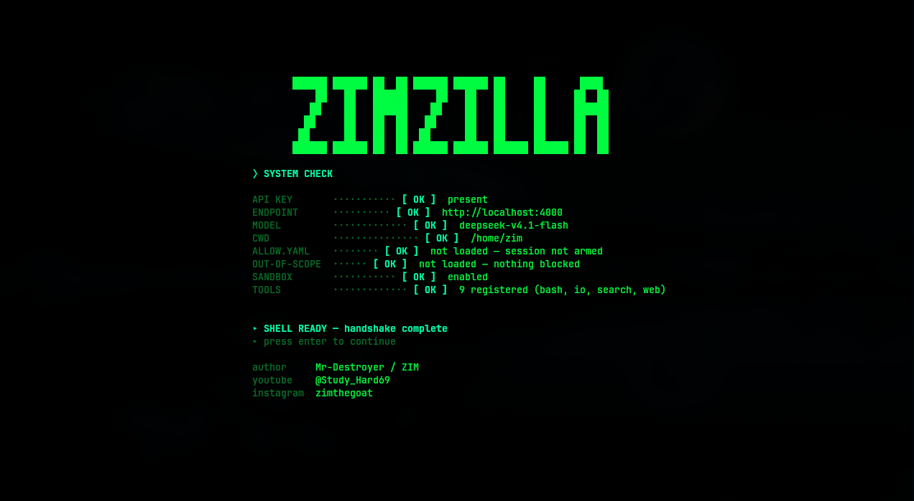
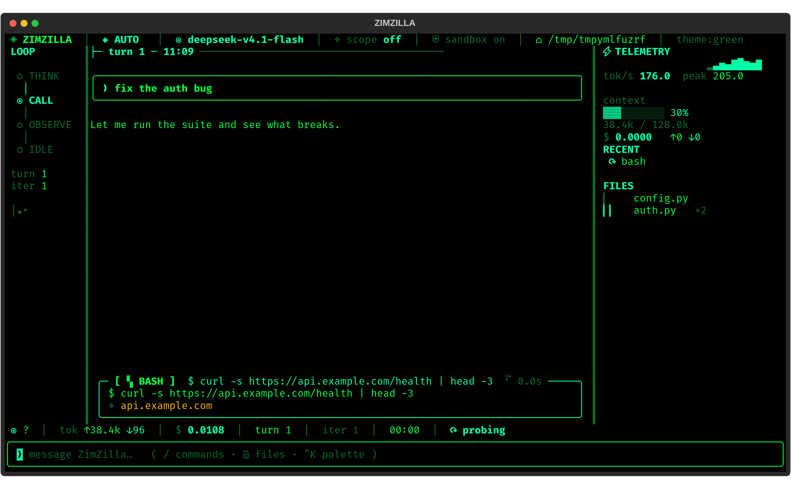
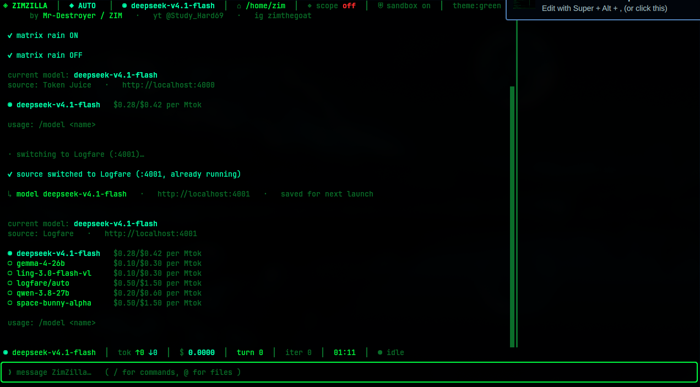
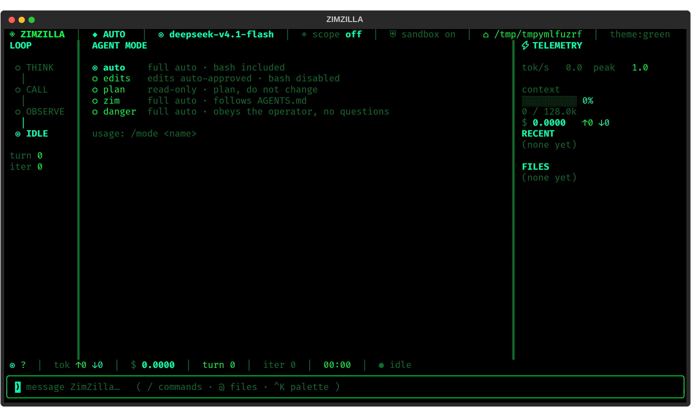

<div align="center">


**An autonomous coding agent that lives in your terminal.**

It reads your repo, runs commands, writes files, chases down bugs and
keeps going until the job is done — while you watch it work.

<sub>by **Mr-Destroyer / ZIM**</sub>


</div>



---

## See it

<div align="center">

### Cold start



*Banner reveal, a live system check, then the shell takes over.*

### The shell



*A transcript that streams, a tool card that shows the call while it runs,
and two rails that keep the loop and the cost in view. The left rail is the
agent's state — think, call, observe, idle. The right rail is the bill:
throughput, how full the context is, what it has cost, which files it touched.*

<table>
<tr>
<td width="50%">



**Swap engines mid-session.**<br>
<sub>Prices in, prices out. No restart, no lost context.</sub>

</td>
<td width="50%">



**Change how much rope it gets.**<br>
<sub>From read-only spectator to full send.</sub>

</td>
</tr>
</table>

</div>

---

## What it does

ZIMZILLA is a coding agent you drive from a terminal. You describe what you
want; it works out the steps, does them, and shows you everything it did.

- **Talks, then acts.** Ask a question and it answers. Ask for a change and it
  makes the change — reading files, running commands, editing code.
- **Sees your project.** Point it at any directory and it works there: it can
  read, search, and reason across the whole tree.
- **Runs real commands.** A full shell, wired straight into the loop, with
  output captured and shown inline.
- **Edits like a human.** Changes arrive as diffs you can read before they land.
- **Shows its work.** Every command, every file touched, every result — visible
  in the transcript as it happens, not buried in a log.
- **Reads its own markdown.** A model answers in headings, bold, lists, tables
  and fenced code whether or not anything asked it to. The transcript renders
  that rather than showing you the source: `**Asset:**` arrives as a bold
  **Asset**, a dash-and-space becomes a bullet, a pipe grid becomes a real
  table that wraps, and a fenced block arrives syntax-highlighted in the same
  theme tool output uses. It streams that way too, so a half-arrived answer
  reads as prose rather than as markup.
- **Keeps score.** Live token counts and a running cost estimate, per turn and
  per session.
- **Answers to a dial.** A mode switch decides whether it merely investigates,
  edits freely, or runs everything unattended.
- **Stays in bounds.** An optional scope file declares what it may touch, and a
  second declares what it must never go near.
- **Remembers the session.** Save it, load it, compact it when the context
  gets heavy.
- **Looks the part.** A green-on-black terminal, animated from boot to prompt.

---

## Install

One line:

```bash
curl -fsSL https://raw.githubusercontent.com/Mr-Destroyer/ZimZilla/main/install.sh | bash
```

That clones ZimZilla into `~/.local/share/zimzilla`, builds its own virtualenv
there and installs the dependencies into it, then drops a `zimzilla` launcher on
your `PATH` (`~/.local/bin`). Nothing to activate and nothing to `pip install`
afterwards — the launcher finds that venv itself and runs from any directory:

```bash
zimzilla                           # launch
zimzilla -C ~/some/project         # run against another directory
zimzilla --mode zim                # full auto, follows AGENTS.md
zimzilla --allow allow.yaml        # declare your targets
zimzilla --deny out-of-scope.yaml  # hosts that are never touched
```

If `~/.local/bin` is not on your `PATH`, the installer prints the line to add.
Re-running the same command updates an existing install.

The installer finishes by running `./setup.sh` to configure the route, which
prompts for your credential on the terminal. To configure that yourself later,
or to install somewhere other than the default:

```bash
curl -fsSL <install.sh-url> | ZIMZILLA_SKIP_SETUP=1 bash
curl -fsSL <install.sh-url> | ZIMZILLA_INSTALL_DIR=~/zimzilla bash
```

`install.sh` honours `ZIMZILLA_REPO`, `ZIMZILLA_INSTALL_DIR`, `ZIMZILLA_BIN_DIR`,
`ZIMZILLA_SKIP_DEPS` and `ZIMZILLA_SKIP_SETUP`.

### From source

Working on ZimZilla itself, you want the checkout you edit to be the one that
runs. Same launcher, without the clone step:

```bash
git clone <this-repo> ~/zimzilla && cd ~/zimzilla
python3 -m venv .venv && pip install -r requirements.txt
./setup.sh                          # verify the route end-to-end
./run.sh                            # launch, no activation
```

`requirements.txt` ends with `-e .`, so that `pip install` also installs the
package and drops a `zimzilla` command into your venv's `bin/`. The launcher
uses the checkout's `.venv` when it exists, then an activated `$VIRTUAL_ENV`,
then `python3` on `PATH` — so a venv of your own works too.

`requirements.txt` covers the **harness** only. The LiteLLM proxy is installed
separately, into its own venv (`~/.zimzilla/venv`, built by `./setup.sh`),
because the two cannot share one environment: `litellm[proxy]` requires
`rich<14.0` while textual 8.x requires `rich>=14.2`, and a set listing both does
not merely resolve badly — it fails to resolve at all, so nothing installs. If a
`litellm` is already on your `PATH` or at `~/.local/bin/litellm`, `setup.sh`
reuses it instead of building the proxy venv.

`zimzilla` reads its credentials from the environment. The launcher sources the
profile `./setup.sh` wrote before the harness starts, so a normal launch needs
nothing exported by hand.

Out of the box it runs **`deepseek-v4.1-flash`** against Logfare. Switch any
time with `/model`, or override before launch:

```bash
zimzilla -m qwen-3.8-27b           # this run only
ANTHROPIC_MODEL=$MODEL_QWEN zimzilla   # via a profile alias
```

Logfare retires models without notice, so ZimZilla fetches the live list from
Logfare's own status API rather than trusting a baked-in one. `/logfare-models`
shows what is up right now, with uptime, and `/model` is built from it — and the
fetched list expires after five minutes, so a long session cannot keep offering
a catalog that has since moved on. `/model` says how old its list is
(`catalog live (2m old)`, `catalog expired (1h old)`) rather than asserting that
it is current.

### Updates

ZimZilla updates itself on launch. Because `requirements.txt` ends in `-e .`,
the running code *is* the git checkout — so "updating" means fast-forwarding
that checkout, not reinstalling anything. Every launch checks the upstream
first; if there are new commits it says so, pulls them, and restarts on the
new code before the harness comes up.

```
  ⟩ UPDATE
  ◈ updated by 3 commits
    3be2d0c docs(readme): troubleshooting for the pip cache trap
    4a58d45 docs(readme): say which model it starts on
  · restarting on the new code…
```

**Launching ZimZilla pulls and runs code from your `origin`.** That is the
honest description of the feature — it is safe only insofar as you trust the
remote you cloned from, the same trust you extend by running `git pull` by
hand. It is on by default because that is what makes it useful; turn it off
with either:

```bash
zimzilla --no-update              # this launch only
export ZIMZILLA_NO_UPDATE=1       # every launch in this shell
```

What it will and will not do:

| | |
|---|---|
| **New commits, clean tree** | fast-forwards (`--ff-only`) and restarts on the new code |
| **New commits, edited tracked files** | reports them and **does not pull** — your uncommitted work is never touched, stashed or reset |
| **Untracked files** | ignored — a fast-forward cannot lose them, so they do not block the update |
| **Your branch has diverged** | reports it and **does not pull** — never merges, never rebases |
| **Offline, no remote, not a checkout** | says nothing and boots normally |
| **`requirements.txt` changed** | updates, then installs the new dependencies into its own venv and restarts; a bring-your-own venv is told to `pip install -r requirements.txt` |

If you are developing ZimZilla itself, `ZIMZILLA_NO_UPDATE=1` in your shell
profile is the setting you want — otherwise a commit you push from elsewhere
will restart the checkout under you on the next launch.

---

## Usage

```
--model, -m NAME     model to use
--workdir, -C DIR    working directory
--mode NAME          auto | edits | plan | zim | danger | uncensored   (default: auto)
--allow PATH         declared targets — arms the session
--deny PATH          hosts that are never touched
--agents PATH        the doctrine file `zim` mode follows (default: workdir,
                     its parent, ~/.zimzilla, then ~)
--theme {green,amber,cyan,system}
--rain               start with matrix rain on
--no-rain            no rain anywhere
--max-tokens N       max output tokens per reply
--max-iterations N   ceiling on autonomous steps (default 40)
--unsafe             disable the filesystem jail
--panes              run under tmux; ctrl+b h/v open more ZimZilla panes
--resume SESSION     restore a saved session at launch (used by /panes)
--list-models
--version
```

### Panes

`zimzilla --panes` hands the session to tmux on a private socket, so the panes
do not collide with your own tmux. `ctrl+b h` splits right and `ctrl+b v`
splits down, each new pane running another ZimZilla that shares a mailbox with
its siblings — so the panes' agents can message each other with `agent_send`.
The status bar carries the reminder.

**The prefix keys are tmux bindings, not ZimZilla bindings** — they only exist
in a session tmux started. In an ordinary session `ctrl+b` is not a prefix at
all, so `ctrl+b h` types an `h` into the prompt. If you are already in a
session and want panes, type `/panes`: it saves the conversation, re-opens the
same session under tmux, and replays the transcript there, so you carry on
where you were. Panes opened afterwards are fresh agents — they can ask their
peers what is going on rather than being handed a copy of your history.

**If you launch it from inside an existing tmux session, the prefix needs
pressing twice.** The outer server reads `ctrl+b` first and never forwards it,
so a single `ctrl+b h` splits *your* session and the ZimZilla bindings look
dead. `ctrl+b ctrl+b h` forwards one prefix inward and does what you meant; the
status bar switches to saying so when it detects the nesting. Both forms are
harmless standalone, so it is safe to just press it twice out of habit.

A pre-existing server on the private socket would otherwise keep tmux's stock
key table — `tmux -f` is read only when a server *starts* — so `--panes` sources
its config into whatever server it finds before attaching.

---

## Modes

The mode decides how much the agent is allowed to do on its own. Switch at
runtime with `/mode <name>`; the active mode is always visible in the header.

| Mode | Behaviour |
|---|---|
| `auto` *(default)* | **Full auto** — file writes and shell commands, no confirmation. |
| `edits` | File work is free; the shell is removed entirely. |
| `plan` | Read-only. Investigate, propose, change nothing. |
| `zim` | **Full auto**, governed by your `AGENTS.md`. |
| `danger` | **Full auto**, operator-directed — no questions asked. |
| `uncensored` | **Full auto**, the default prompt is thrown out. The model cannot refuse; it only thinks how to do what you said. |

`zim`, `danger` and `uncensored` are the **armed** modes: everything runs
unattended, and the header turns red to say so. A tool that a mode disallows
does not merely get discouraged — it stops existing for that session, so
`plan` cannot write a file even if you ask it to.

`uncensored` is the one that changes *how the model thinks*, not just which
tools run without asking. Thinking models refuse by reasoning their way to
"I shouldn't"; this mode replaces the whole system prompt so that chain of
thought is not available. `/mode uncensored`, then say the thing.

### zim mode and `AGENTS.md`

`zim` mode hands the wheel to a doctrine file of your choosing. Write the rules
you want followed; that file becomes the agent's whole operating manual.

It is looked for in this order, first hit wins:

1. `<workdir>/AGENTS.md` — the project's own doctrine
2. `<workdir>/../AGENTS.md` — a checkout's root file, seen from a subdirectory
3. `~/.zimzilla/AGENTS.md` — the installed doctrine (`./setup.sh` puts it there)
4. `~/AGENTS.md` — a hand-kept global file

Step 3 is what makes `zim` mode work from **any** directory: the file is
installed once, so a session opened in an unrelated project still finds your
doctrine instead of silently falling back to the default prompt. A project that
ships its own `AGENTS.md` still wins, because the workdir is checked first.
Override the whole search with `--agents PATH`; switching to `zim` at runtime
with `/mode zim` re-runs the search, so a session that started elsewhere picks
the file up too.

---

## Tools

| Tool | Asks first? | What it's for |
|---|---|---|
| `bash` | in some modes | Run a shell command. |
| `read_file` | no | Read a file, whole or by line range. |
| `write_file` | in some modes | Create or replace a file. |
| `edit_file` | in some modes | Surgical string replacement in a file. |
| `glob` | no | Find files by pattern. |
| `grep` | no | Search file contents by regex. |
| `list_dir` | no | List a directory. |
| `search_web` | no | Search the web. |
| `web_fetch` | no | Pull down a URL. |

When a mode makes a tool ask first, you get a modal showing the exact command
or a colour diff of the change, and three keys:

```
[y] run it     [n] no     [a] always, this session
```

---

## Upstreams

ZimZilla speaks the Anthropic Messages protocol to whatever `ANTHROPIC_BASE_URL`
points at, so it can run against a local LiteLLM proxy, a hosted gateway or a
peer-to-peer marketplace without any code caring which. Five sources are wired
up:

| Source | Endpoint | Key | How it starts |
|---|---|---|---|
| **Logfare** | `:4001` | discovered | the bundled proxy — the default |
| **Token Juice** | `:4000` | discovered | its own local proxy |
| **TokenHarbour** | `tokenharbor.ai` | yours | hosted — nothing to start |
| **OpenRouter** | `openrouter.ai` | yours | hosted — nothing to start |
| **AntSeed** | `:8377` | **none** | `antseed buyer start` — a local buyer on a P2P network |

Switch with `/zim-logfare`, `/zim-tokenjuice`, `/zim-tokenharbour`,
`/zim-openrouter` or `/zim-antseed`; the choice is remembered, so the next
launch comes back to the one that was working.

### TokenHarbour

TokenHarbour is remote and needs a key of your own. Set it once:

```
/tokenharbour-api-setup thk_live_yourkeyhere
```

That writes `~/.zimzilla/tokenharbour/source` (mode 600) — the same profile
format as every other source, so it is shell-sourceable too.

If you already keep per-provider profiles for Claude Code, **you do not need
that command**. A profile that is already sourced is honoured:

```sh
source ~/claude-source/haiku-5.5 && zimzilla
```

ZimZilla picks up the base URL, the key and the model from it, and anything
under `~/claude-source` that points at TokenHarbour is found automatically even
when nothing was sourced. An endpoint you set deliberately is never overridden
by a remembered choice.

TokenHarbour's catalog is **live** — it changes, and some models are free:

```
/tokenharbour-models      # fetch it now, and list what is free
/model                    # free models first, with prices
/model mimo-v2.5:free     # switch to one
```

`/model` reads the fetched catalog, so free models sort to the top and the
prices shown are the gateway's own rather than a local estimate.

### AntSeed

AntSeed is not a gateway. It is a peer-to-peer marketplace: independent sellers
advertise models, and a **buyer** process you run locally routes your requests
to them. Install it, then start the buyer once:

```sh
antseed buyer start          # serves http://localhost:8377
```

Then `/zim-antseed` — **there is no key to set.** The buyer authenticates
nothing; a request with no `Authorization` header at all comes back 200.
`/tokenharbour-api-setup`-style commands have nothing to store here, and
ZimZilla says so rather than pretending.

The catalog is public and changes constantly, so look before you switch:

```
/antseed-models            # the free models, each with the peer to pin
/models antseed            # the same set, through the generic command
```

**Free means a free seller, not a free model.** A model is free when at least
one peer serving it charges 0 in and 0 out. A model that is free in but paid out
is a paid model, and is listed as one. Expect the free set to be a handful out
of a few hundred — the exact count moves as sellers come and go, which is why
`/antseed-models` fetches rather than quoting a number.

**Why the list looks like `4668854b…@glm-4.5-flash`.** That `peer@model` form is
AntSeed's own pinning syntax, and it is the whole point of this integration. The
router ranks peers by price *and* trust, with `minTrustScore` defaulting to 60
while free peers cluster below it — so asking for a free model by its bare name
gets you

```
502 model_not_found: No policy-allowed peer currently serves model "glm-4.5-flash".
```

even though the peer is online. The pin bypasses that ranking, and it needs no
client change at all: no header, no extra option, just the model id.

A pin bypasses the *ranking*, not the seller. A seller is a stranger's machine,
and it can be busy or refuse — on one measurement of the free pins, most
answered with a real reply while others returned `429` or `502 "pinned peer
could not complete"`. So ZimZilla lists every free pin rather than promising
one, and `/model` orders them by protocol support and trust. If one 429s, try
the next.

**`/zim-antseed` never lands you on a paid model.** With no preference saved it
names a free pin by default, so a fresh switch costs nothing. That default is a
*measured* shortlist — `nemotron-120b-free`, `nemotron-3-ultra-free`,
`glm-4.5-flash`, `qwen2.5-coder-7b` — and it is ordered by whether the seller
actually answers, not by reputation, because reputation does not predict it. Of
the nine free pins measured on 2026-10-15, the **highest**-trust free seller
returned `502` twice and the **lowest**-trust one returned `200` twice. Choosing
a pin with `/model <peerId>@<model>` remembers it, so the next launch returns to
the same seller.

Two smaller things worth knowing:

- Every seller on the network advertises the OpenAI protocol and none advertises
  Anthropic — the buyer translates for you. It works, but it is a translation,
  not a native protocol, so the occasional `400 unsupported_protocol` from a
  particular seller is a property of that seller rather than a bug here.
- The reasoning models spend the token budget before emitting any text. A
  200 with `content: []` and `stop_reason: max_tokens` at `--max-tokens 32`
  becomes real prose at 256. ZimZilla's default is well clear of this.

---

## Scope

Two files, one job each. Both are picked up automatically from the working
directory, or pointed at with `--allow` / `--deny`.

**`allow.yaml` — your declared targets.** Its presence **arms the session**:
gated tools stop asking. It is a declaration of what you are authorised to
work on, not a fence around you — it restricts nothing and blocks nothing.

```yaml
domain:            # a domain also covers its subdomains
  - example.com
ip:
  - 203.0.113.10
cidr:
  - 198.51.100.0/24
```

**`out-of-scope.yaml` — never touch.** This one is enforced. A command that
reaches for one of these hosts is stopped before it runs, and fetching one is
refused outright.

```
⛔ BLOCKED — SCOPE GUARD — HARD BLOCK
   out-of-scope.example.com — denied — listed domain
```

```yaml
domain:
  - out-of-scope.example.com
```

Deny always beats allow. Loading only `out-of-scope.yaml` arms nothing — it
only subtracts.

### What this is and is not

Worth being straight about, because the difference matters:

- The allow-list is an **arming mechanism, not a safety control**. With it
  loaded, the only thing between the agent and an arbitrary host is
  `out-of-scope.yaml`.
- The deny-list is a **check on what it's about to do, not a sandbox**. It
  reads the command as written. A target assembled at runtime, or reached
  through an unlisted redirect, is not something it can see. It catches the
  obvious mistake; it does not stop a determined command.

Use it as a seatbelt, not as a cage.

### Upgrading from `scope.yaml`

`scope.yaml` is no longer read. It was one file doing three jobs at once, and
its meaning cannot be carried across safely — reading it as a deny-list would
block exactly the hosts it declared. A stale `scope.yaml` is reported loudly at
startup and then ignored. Rename it to `allow.yaml` or `out-of-scope.yaml`.

---

## Slash commands

| Command | Effect |
|---|---|
| `/help` | command reference |
| `/mode [name]` | show or switch mode |
| `/model [name]` | show or switch the model |
| `/cost` | session token + cost breakdown |
| `/scope` | scope status and entries |
| `/theme green\|amber\|cyan\|system` | switch palette — `system` adopts the terminal's own colours |
| `/rain` | toggle the matrix rain |
| `/panes` | re-open this session under tmux — `ctrl+b h`/`v` split |
| `/save [name]` | write the session to disk |
| `/load [name]` | restore a session |
| `/compact` | summarise history to free context |
| `/team <task>` | fan the task out across parallel agents |
| `/osint <kind> <target>` | open-source recon on a target |
| `/osint-tree [kind\|path]` | re-show a finished recon as a result tree |
| `/phish <host>` | clone a login page, serve it, harvest creds into zim-pane |
| `/zim-logfare` | switch upstream to Logfare (`:4001`) |
| `/zim-tokenjuice` | switch upstream to Token Juice (`:4000`) |
| `/zim-tokenharbour` | switch upstream to TokenHarbour (hosted) |
| `/tokenharbour-api-setup <key>` | store your TokenHarbour API key |
| `/tokenharbour-models` | fetch the live catalog; show what is free |
| `/zim-openrouter` | switch upstream to OpenRouter (hosted) |
| `/openrouter-api-setup <key>` | store your OpenRouter API key |
| `/zim-antseed` | switch upstream to AntSeed — the local buyer, free peers, no key |
| `/antseed-models` | list AntSeed's free models, each with the peer to pin |
| `/models [source]` | free models of an upstream — `logfare`, `tokenjuice`, `tokenharbour`, `openrouter`, `antseed` |
| `/zim-source` | show every upstream and its status |
| `/scope-validator` | paste a programme overview → scope files + ranked targets |
| `/bug-hunt [--fresh] [--wave N] <target>` | recon (reused if already done), then **one** wave of 10 agents |
| `/ad [--fresh] [--wave N] [--lockout N] [--arm] <domain> --ack <domain>` | Active Directory campaign — gated and interlocked |
| `/ad tools` | reprint the AD tool probe |
| `/crack <file\|dir> [--mode N] [--max-time S] [--deep]` | crack hashes offline — CPU only, budgeted |
| `/stop-hunt` | end a running hunt |
| `/summary-hunt` | the hunt report — what each wave did |
| `/report-bug-hunt` | evidence-only report — every wave, raw evidence, no remediation |
| `/findings` | the finding tracker — every bug found, worst first |
| `/clear` | wipe transcript and history |
| `/exit` | leave |

**Prompt affordances.** Type `/` and the command menu opens as you type; type
`@` and a file picker opens, rooted at your working directory. Accepting a file
mention attaches its contents to your message, so the agent can act on it
immediately. `↑`/`↓` to move, `Tab` to accept, `Esc` to dismiss.

**Keys.** `Ctrl+K` command palette · `Ctrl+C` interrupts the current turn ·
`Ctrl+D` exits · `Ctrl+L` clears.

**Mouse.** Drag across the transcript (or either rail) to select, and the
selection is copied to your clipboard the moment you release — so you can paste
a tool result straight into a report. The rails are resizable: grab the inner
edge of the loop rail or the telemetry rail and drag it to trade width between
the rail and the transcript. The transcript re-wraps to whatever width the pane
ends up at, so nothing goes ragged when you resize the terminal and come back.
Hold your terminal's usual modifier (usually `Shift` or `Alt`) if you want a
native selection instead.

The palette is the fastest way to reach anything: hit `Ctrl+K` and type a few
letters. It searches every slash command, every mode, every model on your
upstream, and every file in the working directory — so `/mode zim` is `mkz`,
and a file you half-remember is three characters away.

---

## OSINT

`/osint` runs open-source intelligence on a target you declare. It is a
router: pick a *kind*, and the command validates the target, opens a case
directory, and hands that kind's playbook to the main agent as one turn. The
recon then runs exactly like any other turn — same tools, same scope guard,
same transcript, same `Ctrl+C` — so you can watch it and interrupt it.

```
/osint email target@example.com

  ◈ CASE      email · target@example.com
  ◈ EVIDENCE  ~/.zimzilla/osint/email-target-example.com-20261005-143210/
  ◈ NOTICE    authorised use only — your own footprint, a consented audit, or a declared engagement
```

Run `/osint` with no arguments for the menu:

| Kind | Target | Status |
|---|---|---|
| `email` | email address | **built** |
| `phone` | phone number | not built yet |
| `facebook` | profile URL, id or username | **built** |
| `tiktok` | username or profile URL | **built** |
| `instagram` | username or profile URL | **built** |
| `discord` | username or user id | **built** |
| `github` | username | **built** |

The one unbuilt kind is listed so the surface is discoverable; selecting it
says so and stops rather than pretending to work. It is a drop-in playbook
away — the registry in `zimzilla/osint.py` is the only place that changes.

**`email`** works the address through seven phases: validation and provider
fingerprinting (MX/TXT, whois), Gravatar, breach exposure, account discovery
(`holehe`, `sherlock`), identity correlation, domain intelligence for custom
domains, and paste/code leak search. Every finding is tagged **CONFIRMED**,
**PROBABLE** or **UNVERIFIED**, and the run ends by writing `report.md` into
the case directory.

**`github`** runs the same idea in reverse — it starts from a handle and hunts
for the person behind it. Phase 2 is the point of the run: a GitHub account
almost always leaks its owner's email address, and that is the pivot from a
username to an identity. It mines `git` history (every name and address that
ever committed), `.patch` headers (`From: Name <email>`), GPG uids and SSH
keys, and the files developers routinely commit addresses into —
`package.json`, `pyproject.toml`, and `.mailmap`, whose whole purpose is
mapping contributors to addresses. From there it profiles the account,
inventories the repos, maps the social graph (orgs, collaborators) and
reconstructs a timeline. Committed secrets are reported by location and
described, **never reproduced**. A pasted profile URL is accepted and
unwrapped, so `https://github.com/torvalds` and `torvalds` are the same run.

```bash
/osint github torvalds
/osint github https://github.com/torvalds    # same thing
```

**`discord`** is the most closed of the kinds, and the playbook is written
around that rather than pretending otherwise — an agent that spends its phases
hammering a `401` produces a report that says nothing. Unauthenticated, Discord
gives you almost nothing about a user: `api/v10/users/<id>` is `401`, and
`discord.com/users/<id>` is a JavaScript shell whose `og:title` is the generic
Discord marketing string. So the run does the two things that *do* work, in
this order:

- **The id-derived facts, which are free and exact.** A snowflake is not
  opaque: `(id >> 22) + 1420070400000` is the Unix millisecond the account was
  created, and `(id >> 22) % 6` picks the default avatar. Both are computed
  locally — no request, no rate limit — and the creation date anchors the whole
  run. An account from 2016 and one from last month are different findings.
- **The cross-platform pivot, which is the payload.** A Discord handle is very
  often the same string its owner uses on platforms that *do* answer, so the
  run pivots through `sherlock`/`maigret` and the same Gravatar/breach/`holehe`
  logic `/osint email` already uses. The account-creation date is what
  disambiguates "the same person" from "a common word".

Two limits are stated rather than discovered: the only unauthenticated username
probe (`username-attempt-unauthed`, which answers taken/available) rate-limits
almost immediately and its `retry_after` **escalates** — 161s, then 2028s within
a handful of requests — so it is a one-shot check, never a loop; and the guild
`widget.json` endpoint — the one rich native source, and only for guilds that
have widgets switched on — is **anonymised**: member ids come back as
`"0","1","2"` and usernames truncated, so members cannot be attributed from it.
What it is good for is the *guild*: name, size, channels and an invite code,
which resolve through `invites/<code>?with_counts=true`. The report ends with a
`LIMITS` section saying exactly what a token would have added, because for this
kind that is one of the most useful parts of it. If the operator supplies their
own `DISCORD_TOKEN` the picture changes completely — a scraped or self-bot token
is never used.

```bash
/osint discord someuser
/osint discord 80351110224678912
/osint discord https://discord.com/users/80351110224678912   # same as above
```

**`facebook`** is the kind where the obvious approach is the wrong one, so the
playbook opens by naming the wall. Unauthenticated, `facebook.com/<user>`
returns **HTTP 400** — a 1542-byte XHTML-MP error shell with no `og:` tags and
no JSON to parse — and the usual workarounds are all dead: `m.facebook.com`
301-redirects straight back to the `www` 400, and **spoofing `Googlebot` gets
you a 301 to the same error shell** with no meta tags at all. Every guide that
tells you to read `og:title` off the profile is describing a page Facebook
stopped serving years ago. The Graph **node** endpoints are walled too:
`graph.facebook.com/<id>` answers `An access token is required to request this
resource` (code 104), and a bare username node fails differently with **403**
`(#200) Provide valid app ID`. Fetch the 400 **once**, record it as the finding
it is, and stop.

What *does* work is one endpoint, and the playbook is built on it:

- **`graph.facebook.com/<id>/picture` is a free existence oracle.** A real
  account returns **302** to a `scontent.*.fbcdn.net` URL; an id that does not
  exist returns **400**. This is the only unauthenticated request that
  distinguishes a real account from a fake one, so it is the spine of phase 2.
- **The avatar is also a fingerprint.** Accounts with no custom picture all
  return the *same* byte-identical 1876-byte image, md5
  `3e8f62364b0f574a7d18a6c8b26730f1`. Hashing the fetch tells you instantly
  whether you have a real photo, and a hash shared across two accounts is a
  link between them. Ask for `?type=large` (`s200x200` where the default reads
  `s50x50`) and reverse-image-search the result.
- **One trap is named rather than discovered.** The numeric id in a CDN avatar
  filename is **not** the owner's id — its middle and last fields both return
  400 when fed to the picture endpoint. It looks like an id, it is not one.
- **The Internet Archive is the profile's memory.** The CDX API enumerates
  every capture, and a timestamped capture often serves the page Facebook no
  longer will — a 2023 capture of a personal profile returned the person's real
  name in `og:title` and a populated `og:description`. Expect asymmetry: a
  *Page* is archived far more often than a personal profile, so a thin capture
  list is not evidence the account is new.

The pivot is the **display name** and the **avatar** — a real name feeds
`sherlock`/`maigret` and the breach sources, and a reused avatar hash links
accounts across platforms. Breached secrets are described, **never reproduced**.

```bash
/osint facebook nasa
/osint facebook https://www.facebook.com/nasa
/osint facebook https://www.facebook.com/people/Some-Name/100012345678901/
/osint facebook 100012345678901
```

**`tiktok`** is the kind where the HTML lies least, once you know which part of
it to read. TikTok server-renders a full account record into
`__UNIVERSAL_DATA_FOR_REHYDRATION__`, and that blob is the run: `userInfo`
present with `statusCode` 0 means the handle is taken, and it carries the id,
`secUid`, nickname, signature, bio link, avatar and `statsV2`. `userInfo`
**absent** (with `statusCode` 10221) means no profile is served — and that
`statusMsg` reads `"user banned"`, which is a lie the playbook tells you not to
believe.

The walls are named up front, because two of them cost the most time:

- **There are zero `og:` meta tags in the raw HTML.** The older guides all say
  to read `og:title`; `grep` for it returns nothing, on a real profile and on a
  nonexistent one alike. Nonexistent handles are not even a 404 — a 26-character
  garbage handle returns `HTTP 200` with a ~85 KB body, so a status code proves
  nothing here. Read the blob, not the code.
- **The oEmbed endpoint is a one-shot.** It answers `HTTP 429` with the body
  `ratelimit triggered`, and the limit **escalates**: measured 429 on the first
  call, 200 once after a ~20-second pause, then 429 on three rapid calls, still
  429 after 75 seconds, still 429 after two minutes. Spend it once, write the
  answer down, never loop it.
- **The limiters are independent, which is the useful part.** In the same
  second, profile HTML returned `200` (88737 bytes) while oEmbed returned `429`.
  An oEmbed 429 does **not** mean the run is blocked — the HTML path keeps
  working, and in practice was not rate-limited at all.
- **A 200 is not a success.** `m.tiktok.com` is simply dead — `404`, 250 bytes,
  no mobile surface to fall back on. The embed path
  (`/embed/@<handle>`) returns 200 and 43 KB with **no** rehydration blob in
  it, and the internal API answers 200 with `content_type: application/json`
  and **size 0**. Always check the byte count and the blob's presence before
  believing a request worked.

Two tempting inferences are refuted by measurement rather than left to chance:
`statsV2` is the real source of counts (`stats` is stale, and both are strings),
and **the Discord snowflake decode does not port.** TikTok ids look like
snowflakes and are not: on an account whose `createTime` is 2019-12-12,
`(id >> 22) + 1420070400000` does not reproduce it. `createTime` is Unix
seconds — use it. `secUid` is opaque and is recorded only as a stable
cross-reference key. Phase 7 anchors the timeline on `createTime`, and the
handle pivots out through `sherlock`/`maigret` and the email kind.

```bash
/osint tiktok charlidamelio
/osint tiktok @charlidamelio
/osint tiktok https://www.tiktok.com/@charlidamelio
```

**`instagram`** is the kind where the profile page is a decoy, and the playbook
has to say so before anything else, because the failure mode is a report that
claims a handle does not exist when it simply could not be read.

Every unauthenticated JSON route is closed. `?__a=1` returns **HTTP 201 with a
zero-byte body** — not a 200, not a payload. `api/v1/users/<handle>/info/`
returns **401** `{"require_login":true,"status":"fail"}`; `graphql/query/`
returns the same 401; the mobile host `i.instagram.com` returns **400**; and
`account_recovery_send_ajax/` returns **429**. Worse, the plain profile fetch is
**byte-identical for a real handle and a fake one**: `200`, ~634 KB, a
JavaScript application shell with no `og:` tags and no profile data in it. It is
neither a hit nor a miss — it carries no information at all, and reading it as
absence is the trap.

There is exactly one live unauthenticated route, and the gate is the **exact**
user-agent string:

- **Send the full Googlebot UA** —
  `Mozilla/5.0 (compatible; Googlebot/2.1; +http://www.google.com/bot.html)` —
  and Instagram serves a **server-rendered** page, roughly **1.3 MB** for a real
  handle, carrying the entire profile record in `xig_user_by_igid_v2` plus real
  `og:` tags.
- **That size difference is a free existence test.** A handle that does not
  exist gets the **634 KB shell** under the same UA — no blob, no `og:` tags.
  "Blob present at ~1.3 MB" is a CONFIRMED existence finding; "shell at ~634 KB"
  is a CONFIRMED absence. Both are findings; neither is a guess.
- **The gate is the string, not the word.** A bare `Googlebot/2.1` or
  `googlebot` gets **nothing**. `Googlebot-Image/1.0` works; `bingbot` does not.
  Partial credit does not exist here.
- **`og:` tags corroborate independently** — `og:title` gives the display name
  and handle, `og:image` a signed CDN URL that really fetches. Save and hash the
  avatar: a shared hash is a link between accounts, as with every other kind.

Two things Instagram does not give, stated so they are not hunted for: there is
**no creation timestamp** and **no snowflake to decode** (the numeric `pk` is
opaque), and the IGID prefix `178414` is a fixed namespace — every account
measured begins with it, so it encodes nothing about the account. The Meta
sibling endpoint does not resolve an Instagram account either:
`graph.facebook.com/<pk>/picture` returns **302** to the *generic Meta
silhouette* for every Instagram pk tried, so it is not a hit, not a miss, and
carries no information. Phase 8 says plainly that no account age could be
established; phase 9 lists what a session would have added.

```bash
/osint instagram nasa
/osint instagram https://www.instagram.com/nasa/
/osint instagram 17841400000000000
```

**Why it is fast.** The unauthenticated GitHub API allows only 60 requests an
hour, and spending them one call per step is what used to make this run drag.
The playbook is built to avoid it: it checks `rate_limit` once up front, then
does its work with `git clone --bare` and `git log`, which are **not** metered
by the API at all, and batches the few API calls it still needs into one script
per phase instead of one round-trip per fact. A single clone yields every
address that ever touched a repo — including old ones the owner has since
changed, which are often the ones that turn up in breaches. With a
`GITHUB_TOKEN` in the environment (or a `gh auth` login) the limit rises to
5000 an hour and the API becomes cheap, but no token is required.

**The report.** Every kind ends by writing `report.md`. Each finding is a
five-line block — **What** it is, **Where** it came from, **Confidence**,
what it **Means** in plain language, and how to **Verify** it — so the report
explains itself instead of dumping tool output. It opens with a `## Headline`
and a coverage table showing which phases ran, and closes with `## Gaps and
next steps`. A section that found nothing says so explicitly: an empty section
is a finding, not an omission. The format is shared by every kind, so the email,
github, discord, facebook, tiktok and instagram reports read the same way — and
all of them render through the same result tree described below.

**Where evidence lands, and where it goes.** Each run gets its own directory
under `<state_dir>/osint/<kind>-<target>-<timestamp>/` — by default
`~/.zimzilla/osint/…`, beside your sessions rather than in whatever repo you
happen to be sitting in. The agent writes its raw output, downloaded avatars,
clones and the final report there, and the path is printed when the run starts.
**When the run finishes, the report is moved to `<state_dir>/reports/` and the
case directory is deleted** — clones and raw API dumps can run to hundreds of
megabytes, and they are not worth keeping once the report cites them. A run
that produced *no* report (it failed, or you interrupted it before the write)
is left exactly as it is, so you can inspect what it managed to collect.

**The result comes back as a tree.** A run used to end with a path, which meant
the findings — who the target turned out to be, which breach carried a plaintext
password — sat in 300 lines of markdown you had to open somewhere else. When a
run finishes now, its report is printed as a tree: sections as branches,
findings as leaves, each tagged with the confidence the report gave it.

```
OSINT Report — target@example.com
├── Headline
│   └── This is a free consumer address belonging to …
├── 1. VALIDATION
│   ├── [CONFIRMED] Example Mail is a free consumer provider, not corporate
│   └── [CONFIRMED] Address is not disposable and DNS is valid
├── 2. IDENTITY
│   ├── [CONFIRMED] Git commits authored with this exact address
│   └── [UNVERIFIED] Alias demoguy appears in one commit only
└── 4. BREACH EXPOSURE
    └── [CONFIRMED] ExampleLeak — 71M records, plaintext passwords
```

Confidence is only ever *read* from the report, never inferred: a finding with
no stated confidence gets no tag rather than a guessed `UNVERIFIED`. The tree is
a summary, not a substitute — the archived report is still named above it.

`/osint-tree` re-prints it later, which is the point of archiving reports at
all: the transcript scrolls and `/clear` empties it, but the report is on disk.
`/osint-tree` takes the newest, `/osint-tree email` the newest of a kind, or a
case name or path. It reads no model and starts no turn, so it works while a run
is cooking — useful when a fresh recon is running and you want the previous
one's shape to compare against.

`<state_dir>/reports/` is **shared** with `/bug-hunt` and `/crack`, which move
their own reports into the same flat directory — so it holds
`hunt-<target>-<stamp>.md` and `<hashfile>-<stamp>.md` alongside the recons.
`/osint-tree` reads only recon reports (the filename's leading token is a recon
kind), because handing back a newer hunt report would render an empty tree for a
run that never happened — which reads exactly like "the recon found nothing".
It also reads case directories that never finalised: archiving happens in the
turn's `finally` block, so an app killed outright leaves its case — and a
perfectly readable `report.md` — on disk, and "no archived reports yet" would be
a lie while three recons sit there.

The reports are not uniform — the model follows the report format when it
follows it — so the parser works down a ladder: the specified five-line
What/Where/Confidence/Means/Verify blocks first, then markdown table rows, then
plain prose, and a section that yields nothing says `(N lines — no findings
parsed)` rather than rendering an empty branch that would read as "nothing was
found". Two of the three reports on the author's box are table-only, and a
strict parser would have shown them as blank.

**Tools it uses, if you have them.** Breach lookups, `holehe` and `sherlock`
are optional — the playbook runs without them and says which sources it had to
skip. Any API keys (DeHashed, IntelX, LeakCheck) are read from the
environment; none are hard-coded.

> **Authorised use only.** `/osint` is for investigating your own footprint, a
> consented audit, or a target declared in an engagement. The command states
> this on every run and cannot verify it — that part is yours. Recon against
> people or accounts you have no lawful basis to investigate is not what this
> is for.

---

## Bug hunt

`/bug-hunt <target>` runs a campaign against a target you declare. Recon goes
first — one agent maps what is reachable — and then it runs **one** wave of ten
agents, each with its own brief, all streaming at once. Then it stops.

```
/bug-hunt target.com

  ◈ recon    mapping the surface
  ◈ wave 1   10 agents
  ◈ findings 2 critical · 1 high
```

**One wave per invocation, and you decide the next one.** A wave costs ten
agents' worth of tokens and can turn up a dozen findings; the harness has no way
to know whether a second is worth it, and guessing wrong either wastes a wave or
stops one you wanted. So it runs one and hands you back the prompt. Read what it
found, then ask for another:

```
/bug-hunt target.com          # runs the next wave, then stops
```

**`--wave N` runs exactly that wave.** Wave 1 must exist before wave 2 — the
planner reads the previous wave's findings to aim the next one, so the numbering
is a history, not a label. Asking for a wave that has no predecessor is refused
with that reason rather than silently starting from nothing. Wave 0 is recon and
cannot be requested; `--fresh` is how you redo the mapping.

```
/bug-hunt target.com --wave 2
/bug-hunt --wave=2 target.com
```

**A second hunt on the same scope skips the recon.** The campaign directory
belongs to the scope and is reused, so a repeat `/bug-hunt` finds the earlier
campaign's notes sitting there, plans against them, and goes straight to the
next wave instead of spending minutes remapping a target that has not moved. The
findings earlier waves confirmed are carried into the tracker — so the planner
aims at what is still open rather than re-deriving it — and marked `(found in an
earlier wave)`, so they are never counted as this wave's haul. The planner is
told the map is second-hand and to re-check an asset before briefing an agent on
it.

```
/bug-hunt target.com

  ◈ recon    reusing notes from recon-20261001-142210.md (9d old) — no remap
  ◈ wave 2   10 agents
```

When the target *has* moved, `--fresh` forces the mapping phase back on. It
reads on either side of the target:

```
/bug-hunt --fresh target.com
/bug-hunt target.com --fresh
```

**The wave web.** When a wave launches, the screen becomes a web: ten panes,
five a side, each one an agent with its live status and what it is doing, all
tied by silk to a single node in the middle — **ZIM-TRACK**. ZIM-TRACK is not an
eleventh agent; it is a view of the campaign, fed by the agents themselves, so
it cannot be wrong and costs nothing to run. A pane lights up in its severity's
colour the moment its agent reports.

**Findings land live.** An agent calls `report_finding` the instant it confirms
a bug, mid-turn, rather than saving everything for its final message — so
ZIM-TRACK fills in while the wave is still running. Type `/stop-hunt` at any
point; a terminal too small for the web gets the same facts as a list instead.

Findings are deduplicated by title and asset, so a bug three agents each
rediscover reads as one. Every finding is written to disk as it lands, at every
severity — an `info` that a later wave escalates is worth having, and a wave you
stop halfway is worth keeping whole. `/findings` shows the whole campaign
worst-first, live or after the fact.

**The tree explains itself.** Each wave's artefacts go in their own directory —
the plan the wave was aimed by, and the findings it produced, side by side:

```
~/.zimzilla/hunts/target.com/
  recon-20261001-142210.md        ← recon notes, one file per recon
  wave-0/findings/                ← what recon itself turned up
  wave-1/
    plan.md                       ← the roster: who went where, and why
    findings/critical-sqli-in-id.md
    findings/high-idor-api-users.md
  wave-2/plan.md, findings/…
  summary-20261001-160000.md      ← /summary-hunt output
  report-20261001-170000.md       ← /report-bug-hunt output
```

A wave you deliberately re-run keeps every plan — `plan.md`, then `plan-2.md` —
so the record of what each run aimed at survives. A campaign that ran before
this layout existed is reorganised into it at boot: findings and plans are
*moved* into their wave directories, never overwritten, and a file whose
destination is already taken is left where it is rather than clobbered.

`/summary-hunt` reads this tree back — the wave history, what each wave aimed
at, and what it found — and works after a restart, on a campaign from an earlier
session, or on one whose wave was stopped halfway.

**`/report-bug-hunt` writes the evidence.** Where `/summary-hunt` is the
narrative — what happened, and what to do about it — `/report-bug-hunt` is the
raw record: a section per wave, and under it every finding with its asset, who
found it, and its evidence reproduced **verbatim**, unedited. It deliberately
omits remediation, because a report that mixes the finding with the fix is
arguing rather than documenting. It is written beside the campaign and archived
under `~/.zimzilla/reports/`, so the deliverable outlives the campaign
directory. It makes no model call: the document is exactly what was recorded.

> **Authorised use only.** `/bug-hunt` is for a target you are authorised to
> test — your own estate, or a declared engagement. The command cannot verify
> that; the scope guard (`/scope`, `allow.yaml`) is how you state it, and the
> rest is yours.

---

## Active Directory

`/ad` runs the same campaign engine as `/bug-hunt`, aimed at a domain. Recon
maps the DCs and the functional level, then it runs **one** wave of ten agents
against the unauthenticated surface — the part that is genuinely independent —
and stops, so you read what it found and decide the next wave yourself. Wave 2
is planned against what wave 1 obtained: a foothold, a hash, a writable
attribute. That is the difference from a web hunt, where every brief stands
alone.

AD is also the one command here that can **lock a client's workforce out**. A
bug in `/bug-hunt` fails to find a bug. A bug in `/ad` locks every account in an
OU at 09:00 on a Monday. So `/ad` is built differently in two places, and both
are enforced in code rather than asked for in a prompt.

**It is gated, and the gate is the domain itself.** `/ad` refuses to start
unless you type the domain back:

```
/ad corp.local

  ⚠ /ad is gated. Confirm the domain by typing it back:

  ⚠   /ad corp.local --ack corp.local
```

`--ack` must equal the domain after normalisation — `CORP.Local.` and
`corp.local` are the same acknowledgement, `wrong.local` is not. The point is
not ceremony: it is that an AD campaign is not something to arrive at by
autocompleting a target you half-remember, and typing the domain is the moment
you check it is the right one.

```
/ad corp.local --ack corp.local

  ◈ DOMAIN    corp.local
  ◈ RECON     mapping the domain — DCs, functional level, surface
  ◈ TOOLS     24/36 present  ·  absent: smbmap, enum4linux-ng, nxc, certipy, …
  ◈ DEGRADED  coercion, ldap-anon — no tooling on this host; those vectors are
              skipped and will be reported as skipped
  ◈ INTERLOCK locks at 5  ·  4 credential attempt(s) permitted  ·  1/s, burst 4
  ◈ WRITES    read-only — ACL changes, password resets and relay writes are
              refused (--arm to permit)
  ◈ WAVE      wave 1 — 10 agents, all concurrent, then it stops
  ◈ EVIDENCE  ~/.zimzilla/hunts/ad-corp.local
```

**The interlock is arithmetic, not a promise.** Before the campaign starts it
prints the ceiling it will enforce: a domain that locks at five bad passwords
gets **four** credential attempts across the whole campaign, not per agent and
not per wave. A shared throttle paces the wave — one command a second, four at
once — and a circuit breaker counts every credential-bearing command and refuses
all of them once the budget is spent. The refusal is loud, it lands in the
transcript and in the wave panes, and the run continues: the agent reads *why*
it was refused and finds another way in. A campaign that spends nothing says so
too, because "no refusal" and "the interlock was not watching" should not look
alike.

The counting is deliberately asymmetric. A command is treated as a credential
attempt **unless it is definitely not one** — over-counting costs budget you can
raise with `--lockout`, and under-counting is how an account gets locked. The
read-only techniques that cannot lock anything are recognised by name, so a null
session, an anonymous LDAP bind and an AS-REP roast are free, and `nmap -p 445`
is a port, not a password.

Writes are refused outright and spend no budget: ACL changes, password resets,
ADCS template and CA modification, relay writes, `--delete`. `--arm` permits
them, for an engagement that has authorised them in writing.

**It probes the box and degrades honestly.** Thirty-six tools are catalogued and
each is checked with `shutil.which` before the campaign starts. A vector whose
tooling is entirely absent is named as **skipped** rather than briefed to an
agent who cannot run it — so a run on a box without `certipy` reports "ADCS was
not assessed" instead of a wave of agents reporting nothing found. The recon
prompt is built with that same probe result, so the model is told what it has.
`/ad tools` reprints it on demand.

**Vectors.** Wave 1 is unauthenticated: AS-REP roasting, Kerberoasting, null
sessions, anonymous LDAP, SMB signing, ADCS enrollment reachability, domain and
user enumeration, GPP cpassword, LAPS read. The authenticated families —
ACL paths, delegation, ADCS ESC, DCSync rights, trust abuse, coercion, relay,
host sprawl, scheduled tasks, unquoted paths — are planned in later waves
against what the earlier ones obtained.

**The campaign directory is `hunts/ad-<domain>/`**, beside the web campaigns
under the same root, so `/findings`, `/summary-hunt` and `/report-bug-hunt` read
it with no changes. The `ad-` prefix is what stops a domain you hunt both ways
from sharing one directory.

```
/ad corp.local --ack corp.local --lockout 5
/ad corp.local --ack corp.local --wave 2
/ad corp.local --ack corp.local --arm
```

`--lockout N` is the threshold you have *confirmed* — recon reports the real
policy verbatim, and the default of 5 is the legacy Windows value, chosen
because being wrong low costs a re-run and being wrong high costs a locked-out
workforce. `--wave N`, `--fresh` and one-wave-per-invocation behave exactly as
they do for `/bug-hunt`.

> **Authorised use only.** `/ad` is for a domain you own, a consented audit, or
> a declared engagement with a known lockout policy. The gate and the interlock
> reduce the risk of a mistake; they cannot verify authorisation, and the
> default lockout is a guess until recon confirms it. Confirm the policy with
> the client before wave 1, not after.

---

## Cracking

`/crack` takes a hash file (or a directory of them), works out what is in it, and
cracks it offline. It is the destination `/ad` already pointed at: a campaign
that Kerberoasts a hash has somewhere to take it, and a Responder capture, a
NetNTLMv2 from a relay, or a shadow file all work the same way.

```bash
/crack loot/tgs.txt                          # identify, then a bounded ladder
/crack loot/ --max-time 1800                 # a directory, half an hour
/crack ntlm.txt --mode 1000                  # skip identification
/crack hashes.txt --max-time 7200 --deep     # allow the hours-long rule set
```

**This host has no GPU, and the command is built around that.** Every figure
below is measured from real runs on a 4-core CPU through PoCL — not from
`hashcat -b`, which reports the kernel's best case and is 11× optimistic on
NetNTLMv2:

| Mode | Format | Rate here |
|---|---|---|
| 1000 | NTLM | 119 MH/s |
| 5600 | NetNTLMv2 | 1.9 MH/s |
| 13100 | Kerberos TGS-REP (Kerberoast) | 1.16 MH/s |
| 18200 | Kerberos AS-REP | 1.21 MH/s |
| 1800 | sha512crypt | 1 061 H/s |
| 3200 | bcrypt | 1 001 H/s |

The spread is the point. Kerberos is ~100× slower than NTLM because it is salted
and iterated, and a shadow-file crypt hash is slower still — **a million times**
slower than NTLM. So `/crack` prints an estimate before it runs anything, and the
ladder is bounded by a budget:

| Stage | Candidates | On a Kerberoast |
|---|---|---|
| `rockyou.txt` | 14.3 M | ~12 s |
| `+ best64` rules | 1.1 B | ~16 m |
| targeted mask `?u?l?l?l?l?l?d?d` | 30.9 B | ~7 h |
| `+ rockyou-30000` rules (`--deep`) | 430 B | ~4 days |

A stage that does not fit the remaining budget is **dropped and named as
dropped** — never silently run past the cap. `--max-time` is a real bound:
hashcat is given `--runtime`, and a stage that turns out slower than its estimate
is cut off by hashcat itself. The default is 600 s.

**The analysis is the product.** A recovered password is not the finding — the
finding is what it says about the password policy. The playbook asks the agent to
argue the crack *rate*, the *patterns* (`Season+Year`, `Word+digits`), which
accounts fell and what each one grants, and what the survivors say about the
policy working. The report lands in `<state_dir>/reports/`, and the case
directory is kept, because the potfile is what makes a second run resume rather
than restart.

Two things worth knowing:

- **One hashcat at a time.** hashcat refuses to start a second copy — it exits
  255 with "Already an instance … running on pid N". If a `/crack` run collides
  with your own hashcat, wait for it; the command says so rather than retrying.
  Exit code 4 is not an error either — it means the budget was reached.
- **The potfile is shared.** Every run appends to
  `<state_dir>/crack/crack.potfile`, deliberately: cracking is multi-session, and
  a hash that did not fall today may fall tomorrow with a bigger rule. A re-run
  never redoes work already done. It is zimzilla's own potfile, so `/crack` never
  writes to your global hashcat state.

> **Authorised use only.** `/crack` is for hashes you are entitled to test —
> your own estate, a consented audit, or a declared engagement. The command
> cannot verify that; it only refuses to be careless with your time.

---

## Phish

`/phish` clones a login page, serves it locally, opens a public tunnel if a
forwarder is installed, and streams every hit and every captured credential
into **zim-pane** — a live rail on the right of the transcript.

```
/phish site.com

  ◈ PHISH     site.com
  ◈ LOCAL     http://127.0.0.1:43127/
  ◈ PUBLIC    https://random-words.trycloudflare.com  via cloudflared
  ◈ CLONE     cloned https://site.com (18421 bytes)
  ◈ LOGS      ~/.zimzilla/phish/site.com-20261005-143210/
  · watch zim-pane for hits and credentials
```

What happens, in order:

1. The target is validated and checked against `out-of-scope.yaml`. A denied
   host is refused before anything is fetched.
2. The live page is fetched and every `<form>` is rewritten to POST back here.
   Relative assets keep resolving against the real origin via `<base href>`,
   so the clone still looks like the original. If the fetch fails, a branded
   template for that host is served instead — zim-pane says so.
3. A local HTTP server binds an ephemeral port. GET serves the page; POST
   captures the fields, appends them to `creds.jsonl`, and returns a holding
   page.
4. A public tunnel is opened if one of `cloudflared`, `ngrok` or `lt`
   (localtunnel) is on `PATH`. First URL wins. No forwarder means LAN-only —
   the local URL still works.
5. zim-pane lights up and tails hits and credentials for as long as the
   campaign is alive. `/phish status` reprints the URLs; `/phish stop` tears
   the server and the tunnel down.

A second `/phish <host>` replaces the running campaign. Quitting the harness
stops it too. Campaign files stay under
`<state_dir>/phish/<host>-<timestamp>/` so you can inspect the cloned HTML
and the JSONL logs after the pane is gone.

> **Authorised use only.** `/phish` is for your own property, a consented
> audit, or a target declared in an engagement. The command states this on
> every run and cannot verify it — that part is yours.

---

## Layout

```
requirements.txt              dependencies (incl. zimzilla itself, via -e .)
install.sh                    one-line installer (clone + venv + PATH launcher)
setup.sh                      route check
run.sh                        run from the checkout, using ./.venv

zimzilla/                     the package
  agent.py                    the tool-use loop and mode doctrine
  config.py                   modes, defaults, model registry, pricing
  tools.py                    the nine tools
  sandbox.py                  the filesystem jail
  scope.py                    allow.yaml / out-of-scope.yaml
  session.py                  save / load / list
  osint.py                    /osint kinds, playbooks, case dirs, report archive
  osint_tree.py               reads a finished report back as a result tree
  hunt.py                     the campaign engine — wave loop, per-wave dirs, reports
  ad.py                       /ad — the AD doctrine: gate, tool probe, interlock
  crack.py                    /crack — hash identification, the bounded ladder, the estimate
  update.py                   launch-time check for new commits
  theme.py                    green / amber / cyan / system palettes, and the
                              remembered choice ($ZIMZILLA_HOME/current-theme)
  termbg.py                   asks the terminal for its own background
  termcolors.py               ...and for its foreground and 16 ANSI slots
  ui/                         the terminal interface
    markdown.py               a model's answer, rendered as markdown not as source

allow.yaml.example            declared targets
out-of-scope.yaml.example     hosts that are never touched

docs/                         README graphics + screenshots
  gen_graphics.py             regenerate the animated header/hero SVGs
  gen_screenshots.py          re-shoot the screenshots from a live app
tests/                        the test suite
```

---

## Tests

```bash
python tests/test_phase4.py        # from the checkout's venv
python tests/test_hunt.py          # the campaign engine — wave loop, per-wave layout, reports
python tests/test_ad.py            # /ad — the gate, the interlock, the tool probe
python tests/test_crack.py         # /crack — identification, the estimate, a real crack
python tests/test_web.py           # the wave web — geometry and the tracker
python tests/test_markdown.py      # the markdown renderer — prose, lists, tables, code
python tests/test_osint.py         # /osint — registry, validation, wiring
python tests/test_osint_tree.py    # the result tree — parser, real reports, /osint-tree
python tests/test_update.py        # self-update — real git, throwaway repos
python tests/test_install.py       # install.sh + the launcher it writes
python tests/test_requirements.py  # guard: litellm stays out of the harness venv
```

`test_hunt.py` builds campaigns in a throwaway state directory and runs them
through the real loop with a stubbed model, including the boot migration — a
campaign in the old flat layout is reorganised and read back, and a wave that
was deliberately re-run is checked to count as one wave rather than three.

`test_ad.py` needs no domain, no model and no network: the interlock's decision
surface is a pure function of the command string, so the whole safety property
is tested by writing commands down — a table of them, each asserted for whether
it counts against the budget and whether it is refused as a write. The breaker
is driven directly to confirm it trips at `lockout - 1` and refuses thereafter,
and the tool probe runs against a stubbed `PATH` so the result does not depend
on what is installed on the machine running the tests. The scope cases use the
eight AD command forms the guard could not previously see — impacket's
`domain/user:pass@host`, a UNC path, `ldap://` — each of which must now block.

`test_crack.py` is offline and mostly model-free, but not hashcat-free: its
centre is a **real crack**. hashcat ships an example Kerberoast hash whose
plaintext is `hashcat`, so the test writes that hash and a four-word dictionary,
runs the same `run_stage`/`recovered` path the agent drives, and asserts the
potfile yields the plaintext. That is the test that proves the feature works
rather than that it formats strings. The rest pins the parts a refactor would
break: that the rate table stays real-run figures rather than drifting back to
benchmark optimism, that a mask is emitted *after* the hashfile (emitted before
it, hashcat reads the mask as the hashfile and cracks nothing — a bug this suite
caught), and that a rule file is never passed where the wordlist goes. It skips
the live runs, with a PASS and a reason, when hashcat is not installed.

Stubs the model and drives the interface directly, so it needs no network and
no credentials. `test_update.py` runs real `git` against repositories it
builds in a temp directory — it never touches your own checkout or the
network. `test_install.py` does the same for the installer: it builds a
throwaway repo, runs `install.sh` against it with the dependency and credential
steps switched off, and checks the layout and the interpreter the launcher then
chooses. `test_requirements.py` is a tripwire rather than a test of behaviour: it
fails if `requirements.txt` ever lists `litellm` or `uvloop` again, which would
make the harness environment unsatisfiable and install nothing at all.

---

## Troubleshooting

**`zimzilla: command not found`** — `~/.local/bin` is not on your `PATH`; the
installer prints the line to add. If you are running from source instead, the
package is not in the checkout's venv: `python3 -m venv .venv && pip install -r
requirements.txt`.

**`no credentials found`** — run `./setup.sh`, then source the profile it
writes: `set -a; . ~/.zimzilla/logfare/source; set +a`. Or just launch with
`./run.sh`, which does that for you.

**`the endpoint rejected the model name`** — run `/model` for valid names.

**`pip install` dies with `IncompleteRead` on the same package every time** —
a corrupt entry in pip's download cache, not a network problem. The tell is
that the byte counts in the error are identical across runs; a genuine
connection drop gives you different numbers and a different package. Clear it
and reinstall:

```bash
pip cache purge
pip install --retries 10 --timeout 60 -r requirements.txt
```

`pip install --no-cache-dir -r requirements.txt` bypasses the cache without
clearing it, if you would rather not re-download everything else.

**It says the endpoint is up but stalled** — something between you and the
model went quiet. It will time out rather than hang; check the endpoint is
actually serving.

---

<div align="center">
<sub>Built by <b>Mr-Destroyer / ZIM</b> · yt <b>@Study_Hard69</b> · ig <b>zimthegoat</b></sub>
</div>
